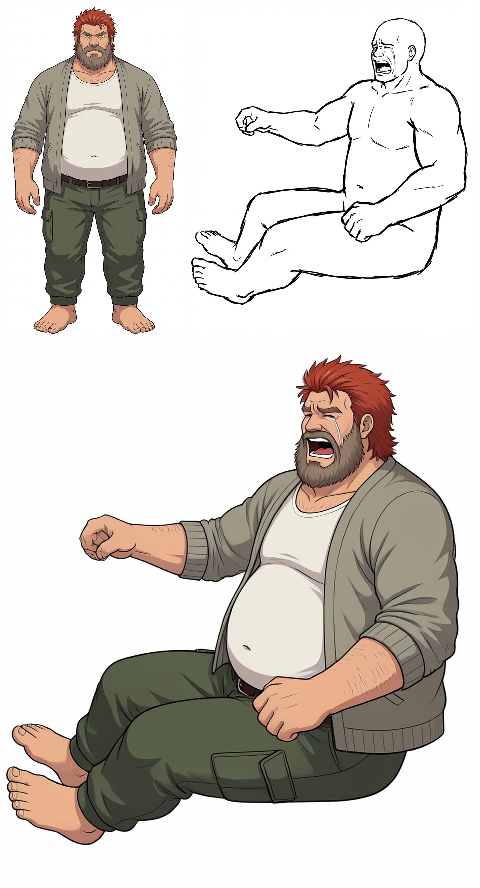
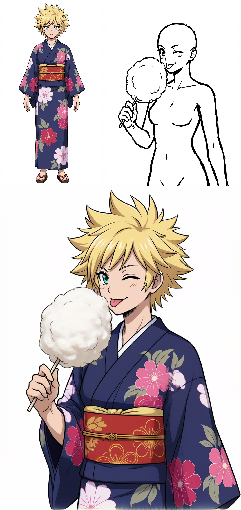
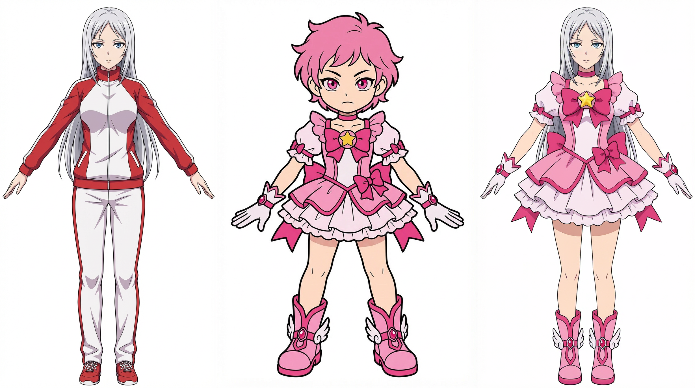

# P-H3-Image ComfyUI サンプルワークフロー

**言語:** [English](README.md) | 日本語

P-H3-Image用の編集可能なComfyUIワークフローを公開しています。キャラクター画像または衣装画像に、もう1枚の参照画像を組み合わせます。下記のPNGは入力・参照・生成結果を並べた例です。結果はシード、モデル、参照画像によって変わります。

## ワークフロー

| ワークフロー | 内容 | 作例 |
| --- | --- | --- |
| [キャラ＋ポーズ](PH3_chara_pose.json) | 画像1のキャラクターデザインと衣装を保ち、画像2のポーズ・表情・画角へ移します。 | [作例を見る](PH3_chara_pose_sample.png) |
| [キャラ＋ポーズ v2](PH3_chara_pose_v2.json) | 先に画像2の可視・画面外・隠れた部位を分析し、画像1から必要なデザインだけを記述します。 | — |
| [キャラ＋ポーズ＋手持ちの物](PH3_chara_pose_held_object.json) | 画像2で手に持っている物の位置や握り方も反映します。 | [作例を見る](PH3_chara_pose_held_object_sample.png) |
| [キャラ＋ポーズ＋手持ちの物 v2](PH3_chara_pose_held_object_v2.json) | 同じ2段階の可視部位分析に、手持ちの物の転写を組み合わせます。 | — |
| [衣装変更](PH3_costume_change.json) | 画像1のキャラ・ポーズ・構図を保ち、画像2の衣装を着せます。 | [作例を見る](PH3_costume_change_sample.png) |

ポーズ系の作例PNGは、上段左がキャラの入力画像、上段右がポーズ・参照の入力画像、下段が出力結果です。衣装変更の作例は横並びで、左からキャラの入力画像、衣装の入力画像、出力結果です。[verification_image](verification_image) に各作例で使った入力画像と、ほかの組み合わせを試せる番号付き画像ペアを収録しています。

### 作例画像

**キャラ＋ポーズ**

**キャラ＋ポーズ＋手持ちの物**

**衣装変更**

## 必要なもの

- `PH3ImageConditioning` と `MiniMaxH3SigmaShift` を含む新しい [ComfyUI](https://github.com/Comfy-Org/ComfyUI)。この2つは下記の拡張ではなくComfyUI本体のノードです。
- ワークフローが選択するP-H3-Imageの重み：

  | ComfyUIのモデル配置先 | ワークフロー内のファイル名 |
  | --- | --- |
  | `models/diffusion_models/` | `p-h3-image_w4a8.safetensors` |
  | `models/text_encoders/` | `p-h3-image_text_encoder_w4a8.safetensors` |
  | `models/vae/` | `p-h3-image_vae_int8_convrot.safetensors` |

- [ComfyUI-VLAnalyst](https://github.com/tori29umai0123/ComfyUI-VLAnalyst)：`QwenVLAnalysisLoader`、`QwenVLAnalysisImage`。ポーズ系は`Qwen/Qwen3.5-9B`、衣装変更は`Qwen/Qwen3.5-4B`を選択しています。選択した視覚言語モデルの配置・ダウンロード方法は拡張の説明を参照してください。
- [ComfyUI_text_Edit](https://github.com/tori29umai0123/ComfyUI_text_Edit)：`TextEditInput`、`TextEditDisplay`、`TextEditJsonPromptTemplate`。
- [ComfyUI-KJNodes](https://github.com/kijai/ComfyUI-KJNodes)：`ImageBatchMulti`、`ImageConcatMulti`。

3つのカスタムノードを`ComfyUI/custom_nodes/`に導入し、各拡張で指定された依存パッケージを入れてからComfyUIを再起動してください。モデルローダー、サンプラー、`GetImageSize`、画像保存・プレビューなどはComfyUI本体のノードです。

## 作例の実行方法

1. 下表の6枚を[verification_image](verification_image)から`ComfyUI/input/`直下へコピーします（サブフォルダには入れません）。各JSONはこのファイル名を初期選択しています。
2. ComfyUIの**Load**またはドラッグ＆ドロップでワークフローJSONを開きます。
3. 2つの`LoadImage`ノードで画像を確認します。独自の画像を使う場合は、ここでキャラ画像とポーズ・衣装の参照画像を選び直します。
4. P-H3の3つのモデルローダーとVL Analystのモデル選択を確認し、実行します。出力は`SaveImage`で保存されます。

| ワークフロー | Picture 1／最初の`LoadImage` | Picture 2／2つ目の`LoadImage` |
| --- | --- | --- |
| キャラ＋ポーズ | [キャラデザイン](verification_image/04_1.png) | [ポーズと表情](verification_image/04_2.png) |
| キャラ＋ポーズ＋手持ちの物 | [キャラデザイン](verification_image/18_1.png) | [ポーズ・表情・手持ちの物](verification_image/18_2.png) |
| 衣装変更 | [変更対象のキャラ](verification_image/25_1.png) | [衣装資料](verification_image/01_1.png) |

作例の出力PNGには、生成時のComfyUIメタデータが含まれています。このリポジトリで管理する版を開くときは、上記のJSONファイルを読み込んでください。

## 補足

- 作例はポーズやキャラの完全一致を保証するものではありません。難しい向きや接触は、シードの変更や別角度の資料が必要になる場合があります。
- 手持ちの物対応版は画像2から物を読み取ります。画像2の手が空なら、出力でも空の手を指定します。
- ポーズ系のv2はVLモデルを2回実行します。最初にポーズ画像の可視部位を判定し、次に両画像から必要なキャラデザインを記述します。画面外の部位を文章に混ぜないことで記述の正確性向上を狙えますが、元の版より推論時間は長くなります。生成モデルには両方の参照画像が渡るため、隠れたデザインが結果に影響しないことまで保証するものではありません。
- 画面比率は、ポーズ転写では画像2、衣装変更では画像1に合わせる構成です。異なる縦横比の画像へ差し替えた場合は、生成前に画面サイズを確認してください。
- このリポジトリにはワークフローとサンプル画像のみを収録し、モデルの重みやカスタムノード本体は含めません。
