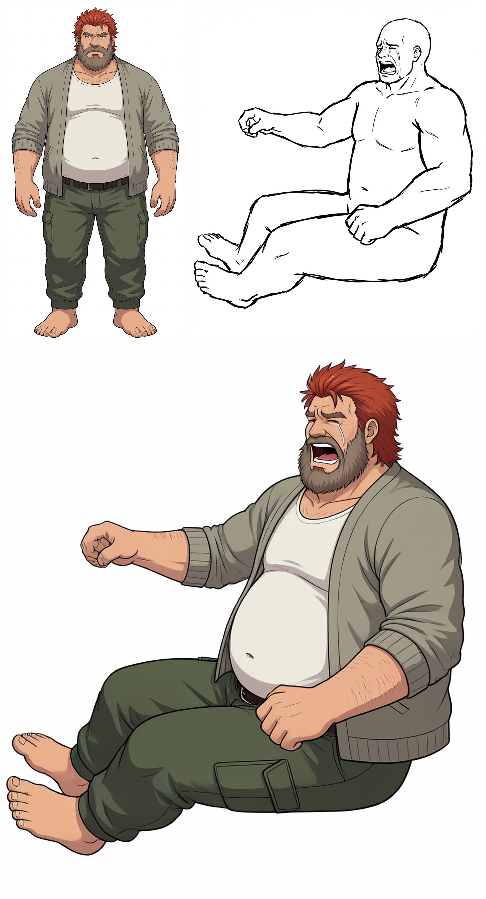
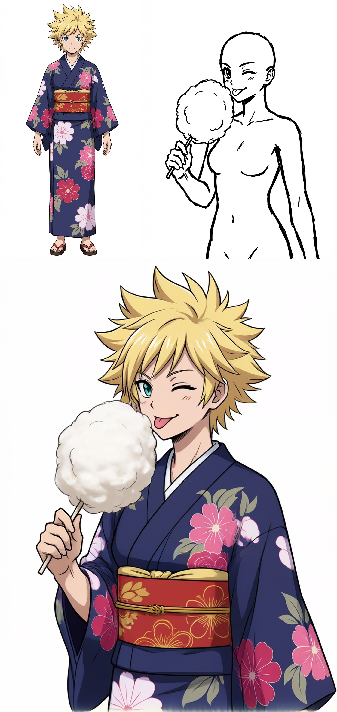
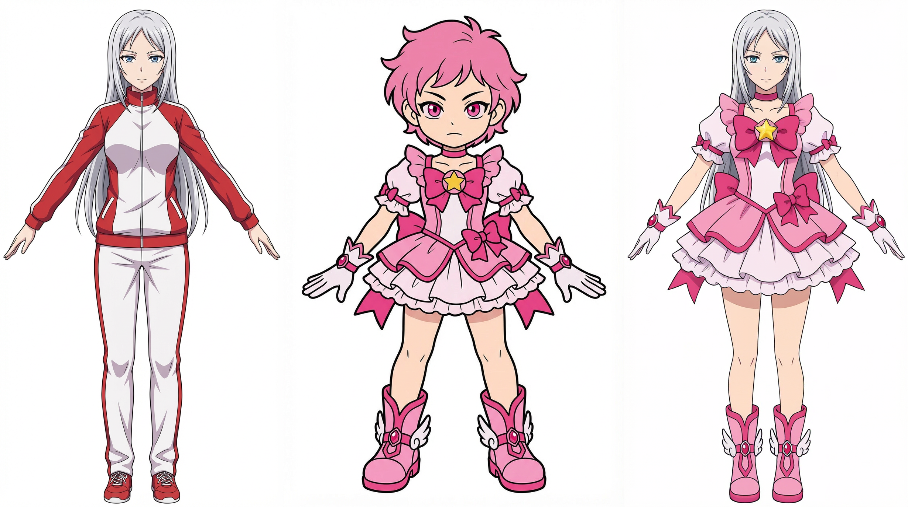

# P-H3-Image ComfyUI sample workflows

**Language:** English | [日本語](README.ja.md)

Editable ComfyUI workflows for P-H3-Image. They combine a character or outfit image with a second reference image. The PNGs below show example inputs and one generated result each; results can vary with the seed, model, and references.

## Workflows

| Workflow | What it does | Example |
| --- | --- | --- |
| [Character + pose](PH3_chara_pose.json) | Applies the pose, expression, and framing of image 2 to the character design and clothing of image 1. | [View sample](PH3_chara_pose_sample.png) |
| [Character + pose v2](PH3_chara_pose_v2.json) | Analyzes image 2 first to find visible, cropped, and occluded regions, then describes only relevant character-design details from image 1. | — |
| [Character + pose + held object](PH3_chara_pose_held_object.json) | Also carries over an object held in image 2, including its placement and the hand contact. | [View sample](PH3_chara_pose_held_object_sample.png) |
| [Character + pose + held object v2](PH3_chara_pose_held_object_v2.json) | Adds the same two-stage visibility analysis while retaining held-object transfer. | — |
| [Costume change](PH3_costume_change.json) | Keeps the character, pose, and composition of image 1 while applying the outfit from image 2. | [View sample](PH3_costume_change_sample.png) |

The pose sample PNGs show the two input images at the top (character on the left, pose/reference on the right) and the generated result below. The costume-change sample is arranged left to right: character input, outfit input, generated result. [verification_image](verification_image) contains the exact input images for these examples and additional numbered pairs.

### Example results

**Character + pose**

**Character + pose + held object**

**Costume change**

## Requirements

- A recent [ComfyUI](https://github.com/Comfy-Org/ComfyUI) build with the built-in `PH3ImageConditioning` and `MiniMaxH3SigmaShift` nodes. These are ComfyUI core nodes, not nodes from the extensions below.
- P-H3-Image weights selected by the workflows:

  | ComfyUI model directory | File selected in the workflows |
  | --- | --- |
  | `models/diffusion_models/` | `p-h3-image_w4a8.safetensors` |
  | `models/text_encoders/` | `p-h3-image_text_encoder_w4a8.safetensors` |
  | `models/vae/` | `p-h3-image_vae_int8_convrot.safetensors` |

- [ComfyUI-VLAnalyst](https://github.com/tori29umai0123/ComfyUI-VLAnalyst): `QwenVLAnalysisLoader` and `QwenVLAnalysisImage`. The pose workflows select `Qwen/Qwen3.5-9B`; the costume workflow selects `Qwen/Qwen3.5-4B`. Follow that extension's instructions to provide or download the selected vision-language model.
- [ComfyUI_text_Edit](https://github.com/tori29umai0123/ComfyUI_text_Edit): `TextEditInput`, `TextEditDisplay`, and `TextEditJsonPromptTemplate`.
- [ComfyUI-KJNodes](https://github.com/kijai/ComfyUI-KJNodes): `ImageBatchMulti` and `ImageConcatMulti`.

Install the three custom-node repositories under `ComfyUI/custom_nodes/`, install their documented dependencies, and restart ComfyUI. Core loaders, samplers, `GetImageSize`, and image save/preview nodes come from ComfyUI itself.

## Run an example

1. Copy the six images linked in the table below from [verification_image](verification_image) directly into `ComfyUI/input/` (not a subfolder). The JSON files select these filenames by default.
2. Open one of the workflow JSON files in ComfyUI, using **Load** or drag and drop.
3. Check that both `LoadImage` nodes show the intended images. For your own run, replace them with your character and pose/outfit references.
4. Check the three P-H3 model loader selections and the VL Analyst model selection, then queue the workflow. The generated image is written by `SaveImage`.

| Workflow | Picture 1 / first `LoadImage` | Picture 2 / second `LoadImage` |
| --- | --- | --- |
| Character + pose | [Character design](verification_image/04_1.png) | [Pose and expression](verification_image/04_2.png) |
| Character + pose + held object | [Character design](verification_image/18_1.png) | [Pose, expression, and held object](verification_image/18_2.png) |
| Costume change | [Character to edit](verification_image/25_1.png) | [Outfit reference](verification_image/01_1.png) |

The sample output PNGs contain ComfyUI metadata from their original runs. Load the JSON files above when you want the versions maintained in this repository.

## Notes

- These are examples, not guaranteed pose or identity matches. Difficult views and contacts may need several seeds or more reference views.
- The held-object workflow reads the object from picture 2. If picture 2 has empty hands, it asks for empty hands in the result.
- The v2 pose workflows run the vision-language model twice: first on the pose image to identify visible regions, then on both images to describe the relevant character design. This can improve the accuracy of the written design description by avoiding details outside the frame, but inference takes longer than in the original workflows. Generation still receives both reference images, so the filter does not guarantee that hidden details will never affect the result.
- All three workflows use the aspect ratio of picture 2 for pose transfer, or picture 1 for costume change, through their existing image-size wiring or conditioning settings. Check the canvas before generating if you replace references with a different aspect ratio.
- The repository contains workflow definitions and sample images; it does not include model weights or custom-node source code.
